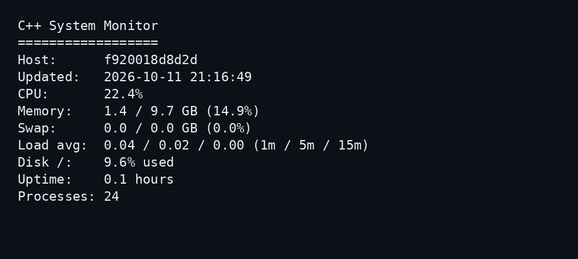

# C++ System Monitor

Monitor de recursos para Linux, desarrollado con C++17.

Lee métricas del sistema directamente desde `/proc` y muestra una vista de terminal sin dependencias externas de ejecución.

## Vista de terminal



Imagen de la salida real de una ejecución local; los valores dependen del equipo y del momento de muestreo.

## Funciones actuales

- Hostname y fecha/hora local de cada lectura.
- Porcentaje de CPU calculado con dos muestras separadas por 250 ms.
- RAM y swap usadas, totales y porcentajes.
- Carga promedio de 1, 5 y 15 minutos.
- Porcentaje de uso del sistema de archivos raíz.
- Tiempo encendido y conteo de directorios de procesos en `/proc`.
- Lectura única o actualización continua, con opción de conservar lecturas anteriores.

## Requisitos

Linux, compilador compatible con C++17 y CMake 3.16 o superior. Esta implementación utiliza interfaces de Linux; Windows y macOS no están soportados.

## Instalación y uso

```bash
git clone https://github.com/DonMilo-22/Cpp-System-Monitor.git
cd Cpp-System-Monitor
cmake -S . -B build
cmake --build build
./build/system-monitor --once --no-clear
```

## Opciones

| Opción | Uso |
|---|---|
| `--once` | Muestra una lectura y termina. |
| `--interval <segundos>` | Espera entre lecturas; predeterminado 1 y mínimo efectivo 1. |
| `--no-clear` | Conserva las lecturas anteriores en terminal. |

```bash
./build/system-monitor --interval 2 --no-clear
```

Interrumpe el modo continuo con `Ctrl+C`.

## Cómo funciona

Consulta `/proc/stat`, `/proc/meminfo`, `/proc/uptime` y `/proc/loadavg`. RAM usada se calcula restando memoria disponible de la total; la carga promedio no es un porcentaje de CPU. El disco raíz se consulta con `statvfs`.

## Almacenamiento y límites

No almacena métricas. La frecuencia total incluye el muestreo de CPU además de la espera configurada. El programa muestra `GB`, aunque convierte memoria usando divisores binarios. El conteo de procesos refleja directorios numéricos de `/proc`, no únicamente procesos ejecutándose en CPU. En contenedores, la vista de `/proc` puede diferir de los límites asignados al contenedor.

## Comprobaciones

La compilación y `./build/system-monitor --once --no-clear` permiten comprobar una lectura local; no sustituyen una suite automatizada.

## Autor y licencia

Desarrollado por [DonMilo-22](https://github.com/DonMilo-22).

Licencia: MIT.

## Actualización 2026-10-12

- Added the number of logical CPU threads reported by the system.

## Actualización adicional 2026-10-12

- Added a small process-to-logical-CPU ratio to help contextualize the process count.

## Historial

Consulta [CHANGELOG.md](CHANGELOG.md) para ver las actualizaciones.

## Actualización 2026-10-14

- Added a warning when root disk usage reaches 90% or more.

## Actualización 2026-10-15

- Added a warning when memory usage reaches 90%; also corrected the disk-usage line and completed its warning statement.


## Actualización 2026-10-16

- System uptime is now displayed as days, hours, and minutes instead of a decimal number of hours for easier reading.


## Utilidad nueva: revisión rápida del disco raíz

Además del monitor completo, puedes compilar una herramienta pequeña para consultar el espacio disponible en `/` y recibir una advertencia al llegar al 90% de uso:

```bash
g++ -std=c++17 tools/disk-space.cpp -o disk-space
./disk-space
```

Requiere Linux y usa `statvfs`; no cambia archivos ni requiere permisos de administrador.
